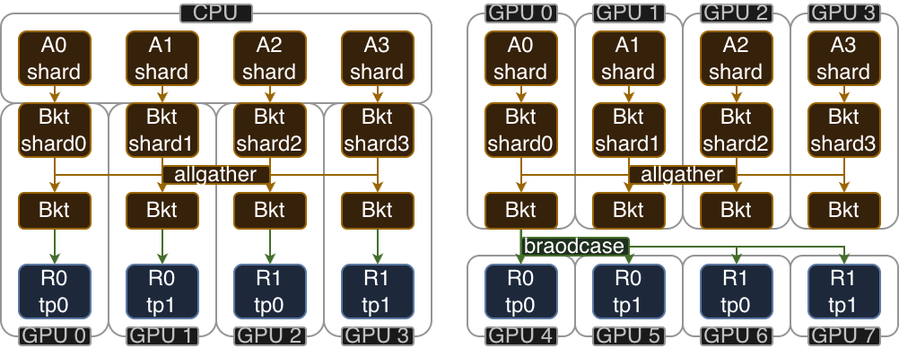

# Placement: actor / critic / rollout

This document describes how slim places the **actor**, **critic**, and **rollout** processes onto GPUs. Note the **actor** oversee both "policy" and "refernce" model and manage with inprocess offload since they share the same compute graph. 

## Notation

Each role declares an overall GPU total. Actor and critic each form one distributed NeMo world, while rollout also declares a per-replica size.

| role | overall total | topology |
|---|---|---|
| actor   | `--actor-num-gpus` (`A`) | FSDP2 with `--context-parallel-size` and `--expert-model-parallel-size` |
| critic  | `--critic-num-gpus` (`C`) | FSDP2 with `--context-parallel-size` and `--expert-model-parallel-size` |
| rollout | `--rollout-num-gpus` (`R`) | `--rollout-num-gpus-per-replica`; replica count is `R / rollout_num_gpus_per_replica` |

| role | within its distributed world | data parallelism |
|---|---|---|
| actor / critic | FSDP2 with context parallelism and optional expert parallelism | pure FSDP across each complete training world |
| rollout | one sglang engine with TP <br> and optional PP / EP / PD-disaggregation | router-balanced (DP) |


## Colocate

**actor**, **critic**, and **rollout** processes can time share same GPUs with colocate.
Slim supports two independent colocate strategy.

| args | meaning |
|---|---|
| `--rollout-colocate` | rollout engines share the **training** GPUs (time-shared via offload) |
| `--critic-colocate` | critic shares the **actor** GPUs instead of taking its own |

## Placement

A single PACK'd Ray placement group (PG) is created over all nodes sorted by `(node_ip, gpu_id)`, then sliced by following per-role offsets (`placement_group.py:create_placement_groups`).

| # | rollout colocate | critic colocate | PG total | critic_offset | rollout_offset | async-capable | layout |
|---|:--:|:--:|:--:|:--:|:--:|:--:|---|
| 1 | ✗ | ✗ | A+C+R | A | A+C | ✅ | <pre>0 1    \| 2 3    \| 4 5 6 7<br>└actor─┘ └critic┘ └rollout┘</pre> |
| 2 | ✓ | ✗ | A+C   | A | 0   | ❌ | <pre>0 1 2 3 \| 4 5 6 7<br>└actor──┘ └critic─┘<br>└rollout──────────┘</pre> |
| 3 | ✗ | ✓ | A+R   | 0 | A   | ✅ | <pre>0 1 2 3 \| 4 5 6 7<br>└actor──┘ └rollout┘<br>└critic─┘</pre> |
| 4 | ✓ | ✓ | A     | 0 | 0   | ❌ | <pre>0 1 2 3<br>└actor──┘<br>└critic─┘<br>└rollout┘</pre> |

### Ray bundle resource quota

Ray abstract each GPU as one PG **bundle** (`{"GPU": 1, "CPU": 1}`). 
When roles colocate, several processes land on the same bundle, so each is given a fractional `num_gpus` quota and Ray only co-schedules them if the quotas sum to `<= 1.0`.
The quotas are **scheduling weights, not memory limits**: GPU memory isolation is disabled (`RAY_EXPERIMENTAL_NOSET_CUDA_VISIBLE_DEVICES=1`), so every co-scheduled process sees the whole card. 

Slim manage time-slicing with offload (`sleep`/`wake_up` premitive).
Slim set fixed quotas: actor `0.4`, critic `0.4`, rollout `0.2`, so all colocate placement are valid.

## Rollout Workers

Rollout generation runs in CPU-only `RolloutWorker` actors outside the GPU placement group.
Agentic rollouts (Docker environments, code execution, agent frameworks) spend much of their CPU outside token generation, so `--rollout-num-workers` spreads that work over several processes and nodes.

```
            ┌──────────── RolloutManager (first rollout node) ─────────────┐
            │ data source · dynamic filter · batch hooks · abort · DP split │
            │ RolloutWorkerPool: per-worker episode load, pending tasks     │
            │ sglang router (child process)                                 │
            └──────▲ RolloutGroup (bulk fields as ObjectRef)  │ RolloutGroup (PENDING)
                   │                                          ▼
  rollout nodes ── N × RolloutWorker (Ray async actor, many groups, capacity ⌈P·c / N⌉)
                   GenerateState · HTTP client · generate_and_rm_group · local Docker daemon
                   ray.put(multimodal_inputs) stays in this node's object store
                   │                                          │ HTTP
                   ▼                                          ▼
  trainer DP rank ── ray.get(TrajectoryBatch)            router → engines
```

| Component | Process | Owns |
|---|---|---|
| `RolloutManager` | one actor on the first rollout node | data source, dynamic filter, batch-level hooks, abort, DP split, logging, tracking, engine lifecycle, router |
| `RolloutWorkerPool` | singleton inside the `RolloutManager` process | worker handles, per-worker episode load, pending group tasks, `aborted` flag |
| `RolloutWorker` | `--rollout-num-workers` async actors, round-robin over the rollout nodes | `GenerateState`, HTTP client, the groups assigned to it |
| generate function | runs inside a worker | example interpretation, media loading, containers, processor outputs |

A dataset example becomes one `RolloutGroup` of `n_samples_per_prompt` episodes.
The group is the dispatch unit, so all episodes of a group run in the same worker.
The framework ships the raw example dict to a worker and does not interpret it.

### Placement and sizing

The rollout nodes are the distinct nodes of the rollout bundles, in sorted bundle order; let $M$ be their count.
`RolloutManager` is pinned to the first rollout node, so the router it launches shares a node with the first rollout engine.
After the rollout servers start, `RolloutManager` creates $N$ = `--rollout-num-workers` workers (default 1) and pins worker $i$ to rollout node $i \bmod M$.
Each worker and `RolloutManager` take `num_cpus=1` outside the placement group, so a rollout node needs one free CPU per worker on it, and the first rollout node needs one more.
`--debug-train-only` has no rollout nodes, so `RolloutManager` is not pinned and no worker is created.

With $P$ rollout replicas (`R / rollout_num_gpus_per_replica`) and $c$ = `--rollout-concurrency-per-replica`, the target episode concurrency is $P \cdot c$ and each worker's episode capacity is $\lceil P \cdot c / N \rceil$.
`--rollout-concurrency-per-replica` also sets the engine's `max_running_requests` and the default `cuda_graph_max_bs_decode`.
Custom generate and reward modules and `--hf-checkpoint` must be reachable from every rollout node.

### Worker

- `RolloutWorker` is an async actor, so every `run_group` call and `abort` run concurrently on the one event loop thread of the actor.
- `run_group` runs `generate_and_rm_group` on the group, then puts each trajectory's `multimodal_inputs` into the node's object store (see [Multimodal Input Lifecycle](data-layout.md#multimodal-input-lifecycle)).
- `GenerateState(args)` is a process singleton holding the tokenizer, processor, chat template kwargs, routing replay shape, and the `aborted` flag.
- `init_http_client()` builds the client without a connection limit and with `trust_env=False`, so proxy variables on a remote node do not capture traffic to the router.
- The worker does not initialize tracking; rollout logging and W&B stay in `RolloutManager`.

### Dispatch

`RolloutWorkerPool.run_group(group, evaluation)`:

1. Return the group untouched if the pool is aborted.
2. Wait for a worker whose episode load is below its capacity, and pick the least loaded one.
3. Add the group's episode count to that worker's load, await `worker.run_group.remote(group, evaluation)`, and subtract it again in a `finally`.

Groups that do not fit anywhere wait in the coordinator, where any worker that frees capacity picks them up.
The coordinator reaches workers only by calling them; workers never call `RolloutManager`, which is a synchronous actor blocked in `generate` for the whole rollout.
A custom `--rollout-function-path` runs in the `RolloutManager` process and reaches the workers through `RolloutWorkerPool(args)`.

The train loop `generate_rollout_async` builds groups, submits them with `pool.submit_generate_tasks`, waits for the first completed task in `pool.pendings`, applies the dynamic filter, and refills until `rollout_batch_size` groups pass.
`over_sampling_batch_size` sets how many groups stay in flight.
The dynamic filter, `--rollout-sample-filter-path`, and `--rollout-all-samples-process-path` run in the `RolloutManager` process on returned groups.

Eval builds one group of `eval_n_samples_per_prompt` episodes per dataset row and gathers `pool.run_group(group, evaluation=True)` over the rows.
`generate_and_rm_group` gives eval episodes session ids, so the `consistent_hashing` router policy routes them by session like train episodes.
Each call waits for its own group, so the eval datasets that `eval_rollout` gathers concurrently share the pool without taking each other's results.

### Abort

Abort is cooperative: nothing cancels a task or kills a process.
`RolloutWorkerPool.abort` runs when the batch is full:

1. Set the pool's `aborted` flag, so pending tasks that have not reached a worker return their group untouched.
2. Call `abort` on every worker, which sets `state.aborted` in that worker. All groups of a worker share its `GenerateState`, and threads the generate function starts through `asyncio.to_thread` read the same object.
3. Post `abort_request` with `abort_all` to every engine behind the router once per second until every pending task has returned. `abort_all` aborts only the requests running at that moment, so the repeat catches requests a worker posted before it saw its flag.
4. Collect the examples of groups that are not `completed` for `data_source.add_examples`.
5. Call `reset` on every worker and on the pool.

The coordinator has its own HTTP client for `GET /workers` and the abort posts, also without a connection limit.
An aborted group returns through the normal path, so its bulk refs are dropped with it.
Every generate function returns on its own, so its `finally` always runs; see the [generate function contract](customization.md#generate-function---custom-generate-function-path).

## Step timeline

### no critic-colocate (# 1 & 2)

When actor and critic are on **disjoint** GPUs they run **concurrently**. Each have their own NCCL world.

```
                 GPU memory resident
phase               A      C      
─────────────────────────────────
1. compute          ■      ■      ref/actor-old log-probs (A) ∥ compute_values (C)
────────────────────┼──────┼──── ◀ critic values ready
2. targets          ░      ░      AdvantageEstimator publishes Episode shards with training targets
3. train            ■      ■      actor.train ∥ critic.train
────────────────────┼──────┼──── ◀ barrier: ray.get(actor.train); ray.get(critic_train_handle)
4. actor.update_wts ■      ░      actor pushes weights → rollout engines

legend:
■ active resident ░ idle resident · offloaded (CPU)
```

### under colocate-critic (# 3 & 4)

When the critic shares the actor's GPUs, the actor and critic **cannot run
concurrently**. Two NCCL worlds issuing collectives on one device will hang or
OOM.

```
                  GPU memory resident
phase                A      C 
─────────────────────────────────
1. critic.wake_up()  ·      ■
2. compute_values    ·      ■        critic forward produces value payloads
3. targets           ·      ░        AdvantageEstimator publishes Episode shards with training targets
4. critic.train      ·      ■        critic consumes old values and value targets
5. critic.sleep() ───┼──────┼──── ◀ HANDOFF: critic is offloaded before actor wakeup
6. actor.wake_up()   ■      ·
7. compute_log_probs ■      ·        optional ref and actor-old log probabilities
8. actor.train       ■      ·        actor consumes advantages
9. actor.update_wts  ■      ·        push weights → rollout engines
10. actor.sleep()    ·      ·

legend:
■ active resident ░ idle resident · offloaded (CPU)
```

Actor and critic construct separate physical packs from the Episode shards containing training targets. This keeps packing and placement role-local. Mismatch correction is also actor-local and runs after actor-old and rollout log probabilities are available.

---

## Weight Update

On-policy RL syncs model weights from the FSDP actor to the SGLang rollout engines at every training step.
Slim treats each engine as an opaque unit of `rollout_num_gpus_per_replica` GPUs.
How the engine internally splits those GPUs (TP/PP/DP/EP) is configured via sglang args and is transparent to the weight update path; the sglang engine discards any param slice it does not need.
The NeMo state-dict adapter converts each tensor to its Hugging Face name and layout before transport.
Each tensor is first cast to the dtype FSDP2 computes it in, so the all-gather and the engine carry the weights the forward uses: BF16 for the bulk of the fp32 master weights, and fp32 for units that compute in fp32, such as Qwen3.5's Gated DeltaNet holders.



### Colocate path

After training, the actor model is offloaded to CPU.
During weight update, params are streamed from CPU to GPU one bucket at a time: each param is moved to GPU, all-gathered across the FSDP mesh, pushed to the engine, then freed.
Only one bucket of params lives on GPU at a time, so the full model never needs to fit in GPU memory alongside the engine.

For each bucket, ranks serialize their tensors as CUDA IPC handles.
Gloo collects all handles to the source rank (first rank in the IPC group, e.g. A0, A2).
The source rank issues a single Ray RPC to the engine, passing all handles.
The engine dispatches each handle to its corresponding TP worker, which opens it from its colocated actor rank (zero-copy, same GPU).
The actual tensor data never crosses GPUs; only the small IPC handle metadata is gathered.

### Separate path

The same FSDP all-gather by buckets followed by 
Only A0 broadcasts to all engine TP workers directly.
Each TP worker receives the full param and keeps only its slice.

### sync with low precision inference

A quantizer quantizes each bucket from BF16 to block-FP8 format between all-gather and send.
Rollout engines receive weights in the same quantized format they were initialized with.

### sync with failed engines

Slim also keeps a heart beat health check on all sglang engines and kills any non-responsive ones. 
The killed engine are restarted before weight sync and receive fresh memory and join next batch of training.
