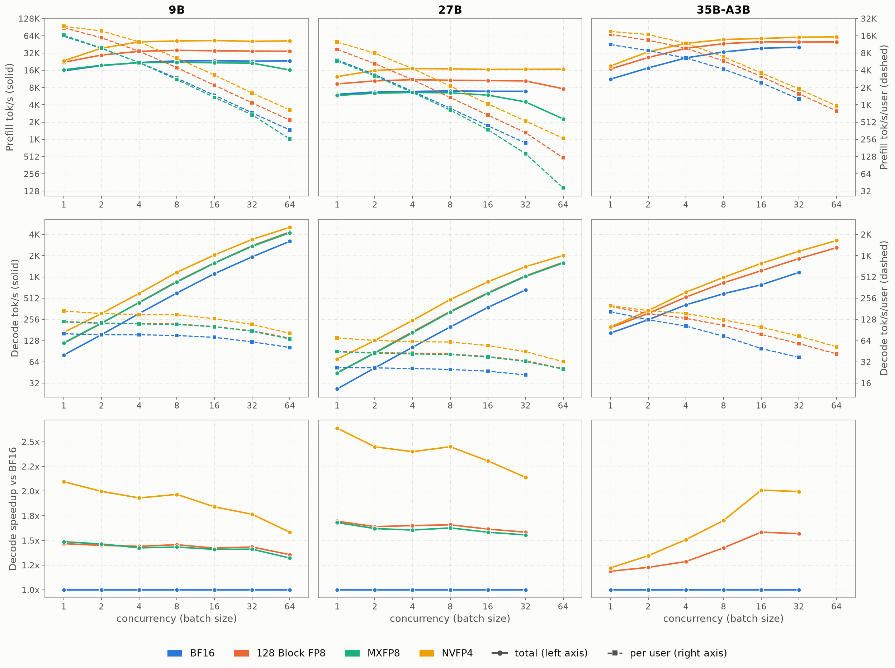
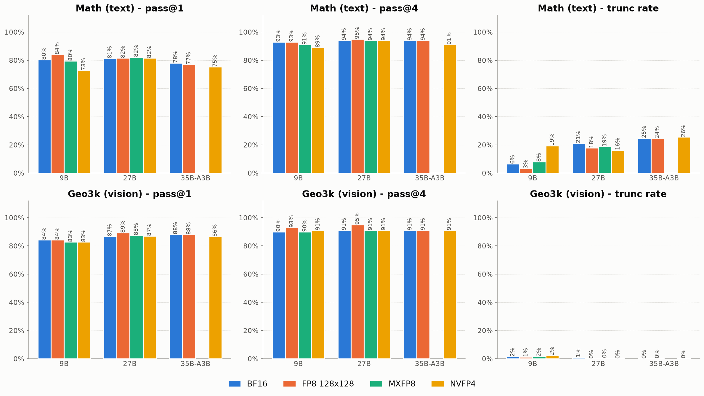
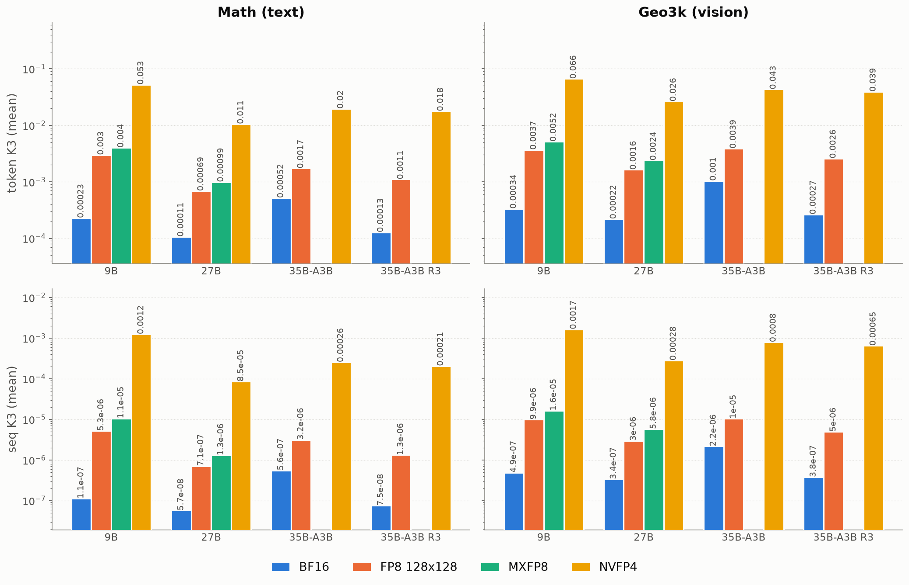

# Low Precision Inference on Throughput, Accuracy, and Training-Inference Mismatch

Rollout stage can take up over half of RL training wall time.
Low precision models (128 Block FP8, MXFP8, NVFP4) can leverage hardware FLOPS and bandwidth to reduce inference time while offering near loss-less performance.
However, low precision inference could introduces training-inference mismatch (TIM)  and numerical instability.
This report compares quantization recipes, including 128 Block FP8, MXFP8, and NVFP4, against BF16 on throughput, accuracy, and TIM.
This report targets low precision rollout and full precision training, i.e. only post-training quantization (PTQ), no quantization aware training (QAT).
Experiments run on RTX-PRO-6000 (SM120) with sglang 0.5.20 and FlashInfer 0.6.18.

## Preliminary

### Models

Qwen3.5 family share 256 `head_dim`, 248320 vocabulary size, and a 3:1 linear/full-attention hybrid ratio.
This report benchmarked **Qwen3.5-9B**, **Qwen3.5-27B** (dense), and **Qwen3.5-35B-A3B** (MoE).

| Model | hidden | head_dim | Q heads | KV heads | Layers (lin/full) | Experts (top-k) |
|-------|--------|----------|---------|----------|-------------------|-----------------|
| Qwen3.5-2B   | 2048 | 256 | 8  | 2 | 24 (18/6)  | — (dense) |
| Qwen3.5-4B   | 2560 | 256 | 16 | 4 | 32 (24/8)  | — (dense) |
| **Qwen3.5-9B**   | 4096 | 256 | 16 | 4 | 32 (24/8)  | — (dense) |
| **Qwen3.5-27B**  | 5120 | 256 | 24 | 4 | 64 (48/16) | — (dense) |
| **Qwen3.5-35B-A3B** | 2048 | 256 | 16 | 2 | 40 (30/10) | 256 (top-8)  |
| Qwen3.5-122B-A10B   | 3072 | 256 | 32 | 2 | 48 (36/12) | 256 (top-8)  |
| Qwen3.5-397B-A17B   | 4096 | 256 | 32 | 2 | 60 (45/15) | 512 (top-10) |

### Quantization Recipes

We used recipes in `tools/quant_recipes/` to produce the quantized checkpoints from the BF16 master weight.
Following modules are kept in **BF16**:
- `lm_head`, `embed_tokens`,
- the linear-attention projections (`linear_attn.conv1d`/`in_proj_a`/`in_proj_b`),
- the vision tower (`visual`),
- the MoE routing gates (`mlp.gate`, `mlp.shared_expert_gate`),
- the MTP head (`mtp.fc`) (not used in this report).

| Precision | Recipe | Format | Activations | Tool | GEMM backend (SM120) | MoE backend (SM120) |
|---|---|---|---|---|---|---|
| BF16 | — | — | BF16 | — | cuBLAS | Triton fused-MoE (sglang's tuned config for this card) |
| 128 Block FP8 | `qwen35_128blockfp8.json` | e4m3, 128x128 blocks, fp32 scales (official Qwen3.5 FP8) | dynamic 1x128 | `tools/convert_hf_to_fp8.py` | sglang CUTLASS block-FP8 | Triton fused-MoE (sglang's default config) |
| MXFP8 | `qwen35_mxfp8.json` | e4m3, 1x32 blocks, UE8M0 scales | dynamic 1x32 | `tools/convert_hf_to_fp8.py` | FlashInfer CUTLASS `mm_mxfp8` | — (SM100 only) |
| NVFP4 | `qwen35_nvfp4.json` | e2m1, 1x16 blocks, e4m3 scales + fp32 global scale | dynamic 1x16, static per-tensor global scale | `tools/convert_hf_to_nvfp4.py` (ModelOpt max calibration on 2048 training prompts) | FlashInfer CUTLASS `mm_fp4` | FlashInfer CUTLASS fused-MoE |

## Throughput

We measured prefill and median decode throughput under input=512, output=1024 workloads and $1\sim64$ concurrency.



Takeaways (speedup vs BF16):
- **Dense models:** 128 Block FP8 gives about 1.5x for prefill and decode. NVFP4 is the fastest format: about 2-2.5x for prefill and decode.
- **MXFP8:** decode matches 128 Block FP8, but prefill gives no gain and falls at large batch. On this card, MXFP8 has no advantage over 128 Block FP8.
- **MoE (35B-A3B):** the decode gain grows with batch size, from about 1.2x at bs 1 to 1.6x (128 Block FP8) and 2x (NVFP4) at bs 16-32. At small batch, each token reads only 8 of 256 experts, so weight bytes are a small part of the step time. The prefill gain shrinks as batch size increases.

## Accuracy

Each model generated **4 samples** per prompt on **100 prompts** from **DAPO-Math-17k** (text) and **Geometry3K** (vision) with 16K max context respectively (`2_infer.py`).
We report **pass@{1,4}** and **trunc rate**.



Takeaways:
- **128 Block FP8 and MXFP8 keep BF16 accuracy.** On every model and task, their pass@1 is within 0.04 of BF16.
- **NVFP4 causes less accuracy loss on larger models.**
  On the 9B math task, pass@1 falls from 0.802 to 0.728 because the truncation rate rises from 6.5% to 19.3%. The accuracy of the untruncated sequences rises (0.834 to 0.870), so the loss comes from longer generations that hit the 16K limit, not from wrong final answers.
  27B NVFP4 keeps BF16 accuracy (math 0.815 vs 0.812, vision 0.870 vs 0.868). 35B-A3B NVFP4 is 0.028 (math) and 0.017 (vision) below BF16.

## Training-Inference Mismatch (TIM)

In RL, generated tokens are sampled from the rollout engine (sglang) under $\pi_{\text{rollout}}$, but the policy-gradient is taken on the training actor (HF/FSDP) $\pi_{\text{train}}$. Quantized inference adds TIM on top of the existing numerical gap (floating point arithmetic is not associative) and expert-routing divergence in MoEs [ref: Rollout Routing Replay R3].

Denote the model-generated token (i.e. the realized token at each step) as $t_i$. The per-token log-ratio and sequence-mean log-ratio are:
$$
\begin{aligned}
\log r_i &= \log\pi_{\text{train}}(t_i) - \log\pi_{\text{rollout}}(t_i) \\
\overline{\log r} &= \frac{1}{L}\sum_{i=1}^{L}\log r_i
\end{aligned}
$$
We measure **TIM** as $\mathrm{KL}(\pi_{\text{rollout}}\|\pi_{\text{train}})$ and report the **k3** estimator (Schulman) at token and sequence level:
$$
\begin{aligned}
\text{K3}_{\text{tok}} &= \mathbb{E}_{\textcolor{red}{t_i} \sim \pi_{\text{rollout}}}\left[e^{\log r_i} - \log r_i - 1 \right] \\
\text{K3}_{\text{seq}} &=\mathbb{E}_{\textcolor{red}{t_:} \sim \pi_{\text{rollout}}} \left[e^{\overline{\log r}} - \overline{\log r} - 1\right]
\end{aligned}
$$
The training forward always uses the BF16 weights (`3_kl.py`), so the KL is exactly the gap RL corrects.



Takeaways:
- 128 Block FP8 TIM is about 9x the BF16 TIM (6-13x), and MXFP8 is 1.3-1.5x 128 Block FP8. NVFP4 TIM is about 150x the BF16 TIM (100-230x).
- **Task:** vision prompts have 24-46% higher TIM than math prompts on the 9B, and 100-140% higher on the 27B and 35B-A3B.
- **R3:** on the 35B-A3B, routing replay reduces TIM by 75% for BF16, 35% for 128 Block FP8, and 10% for NVFP4.

## Reproduce

```bash
uv sync --extra quant                                   # ModelOpt, for NVFP4 calibration
python report/low_precision/0_prepare_eval.py           # eval parquets (datasets/eval/)
bash report/low_precision/0_prepare_models.sh           # 128 Block FP8 / MXFP8 / NVFP4 checkpoints
bash report/low_precision/1_bench_throughput.sh         # Section: Throughput
bash report/low_precision/run_matrix.sh                 # Sections: Accuracy, KL
python report/low_precision/collect_results.py          # Markdown tables
python report/low_precision/make_plot.py                # figures
```
